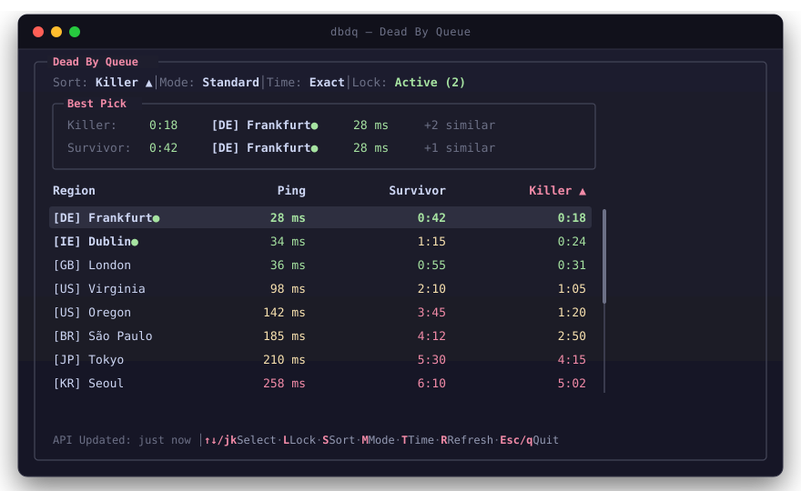

# Dead By Queue (`dbdq`)

[](https://github.com/trazxdxne/dbdqueue/releases)
[](https://github.com/trazxdxne/dbdqueue/actions)
[](LICENSE)
[](https://www.rust-lang.org/)
[](https://github.com/trazxdxne/dbdqueue/releases)

<p align="center">
  <kbd><b>English</b></kbd>&nbsp;•&nbsp;<a href="README.ru.md"><kbd>Русский</kbd></a>
</p>

Terminal queue viewer, AWS latency monitor, and region locker for Dead by Daylight, written in Rust with `ratatui`.

<p align="center">
  
</p>

> Unofficial community tool using the public `deadbyqueue.com` API. Not affiliated with Behaviour Interactive, AWS, or `deadbyqueue.com`. Region locking only modifies your local `hosts` file. See [LICENSE](LICENSE).

## Features

- **Live queues & ping**: Fetches Standard/Event queue times and measures 1-RTT HTTP Keep-Alive latency to all 15 AWS regions, starting instantly from `cache.json`.
- **Best Pick**: Scores active regions by `wait + ping_penalty(role)` (Killers tolerate higher ping than Survivors) and flags `+N similar` options (`±25 ms`, `±15 s`).
- **Region Locker**: Whitelist preferred regions in the TUI (`l`) or CLI (`dbdq lock`) via local `hosts` routing (UAC on Windows, `pkexec`/root on Linux).
- **Event mode**: Shows active event countdowns in the header and upcoming event schedules when event queues are offline (`m`).
- **TUI ergonomics**: Single-frame adaptive layout down to `48x12`, `Exact` / `~Rounded` times (`t`), Latin & Cyrillic keybindings, mouse wheel scroll, and `NO_COLOR`.

## Install

**Windows (PowerShell):**
```powershell
irm https://raw.githubusercontent.com/trazxdxne/dbdqueue/master/install.ps1 | iex
```

**Linux (Bash):**
```bash
curl -fsSL https://raw.githubusercontent.com/trazxdxne/dbdqueue/master/install.sh | bash
```

**Manual / Source:**
- Download `dbdq-windows-x64.exe` / `.zip` or `dbdq-linux-{x86_64,aarch64}` / `.tar.gz` (plus `SHA256SUMS.txt`) from [Releases](https://github.com/trazxdxne/dbdqueue/releases).
- Or build with Rust: `cargo install --git https://github.com/trazxdxne/dbdqueue`

## Usage

Run `dbdq` to open the TUI, or pass flags/subcommands:

```bash
dbdq --sort killer|survivor|ping|default
dbdq --mode standard|event
dbdq --time exact|rounded
dbdq lock [regions...]   # opens interactive picker if empty (e.g. dbdq lock frankfurt dublin)
dbdq unlock              # clears all region locks
```

### Controls

| Input | Action |
| :--- | :--- |
| `↑` `↓` / `j` `k` / Scroll | Move selection |
| `Home` / `End` / `PgUp` / `PgDn` | Jump / page scroll |
| `l` | Open Region Locker (`Space` toggle, `a` all, `i` invert, `Enter` apply) |
| `s` / `m` / `t` | Cycle sort / toggle mode / toggle time format |
| `r` | Refresh queues, events, and pings |
| `q` / `Esc` / `Ctrl+C` | Close modal or quit |

## Config

Stored at `~/.config/dbdqueue/config.toml` (Linux) or `%APPDATA%\dbdqueue\config.toml` (Windows), with ping cache in `cache.json`:

```toml
mode = "standard"             # "standard" | "event"
sort = "killer"               # "default" | "killer" | "survivor" | "ping"
time_format = "exact"         # "exact" | "rounded"
locked = ["eu-central-1"]
lang = "auto"                 # "auto" | "en" | "ru"
# api_url = "https://..."     # custom queue API endpoint
```

Environment variables: `DBD_API_URL`, `HTTP_PROXY` / `HTTPS_PROXY`, `NO_COLOR`.
