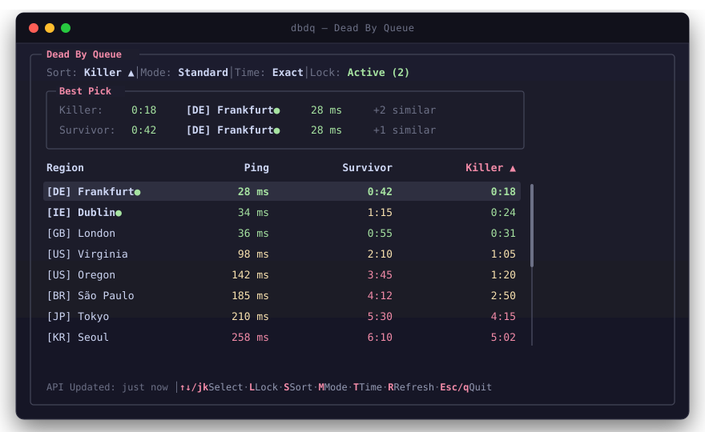

# Dead By Queue (`dbdq`)

[](https://github.com/trazxdxne/dbdqueue/releases)
[](https://github.com/trazxdxne/dbdqueue/actions)
[](LICENSE)
[](https://www.rust-lang.org/)
[](https://github.com/trazxdxne/dbdqueue/releases)

<p align="center">
  <a href="README.md"><kbd>English</kbd></a>&nbsp;•&nbsp;<kbd><b>Русский</b></kbd>
</p>

Терминальный просмотр очередей, задержки до серверов AWS и блокировка регионов для Dead by Daylight на Rust (`ratatui`).

<p align="center">
  
</p>

> Неофициальная утилита на базе публичного API `deadbyqueue.com`. Не связана с Behaviour Interactive, AWS или `deadbyqueue.com`. Блокировка регионов изменяет только локальный файл `hosts`. См. [LICENSE](LICENSE).

## Возможности

- **Очереди и пинг**: Загружает время поиска (Обычный / Ивент) и измеряет 1-RTT HTTP Keep-Alive пинг до всех 15 регионов AWS, мгновенно стартуя из `cache.json`.
- **Лучший выбор**: Оценивает активные регионы по формуле `ожидание + штраф(пинг, роль)` (для Маньяка пинг менее критичен, чем для Выжившего) и отмечает `+N похожих` (`±25 мс`, `±15 с`).
- **Блокировка регионов**: Белый список серверов из TUI (`l`) или CLI (`dbdq lock`) через системный `hosts` (UAC в Windows, `pkexec`/root в Linux).
- **Режим ивента**: Показывает таймер до конца активного события в шапке и расписание ближайшего, если очереди ивента ещё закрыты (`m`).
- **Удобство в терминале**: Адаптивная рамка до `48x12`, форматы `Точно` / `~Округлённо` (`t`), работа на латинице и кириллице, прокрутка колесом мыши и поддержка `NO_COLOR`.

## Установка

**Windows (PowerShell):**
```powershell
irm https://raw.githubusercontent.com/trazxdxne/dbdqueue/master/install.ps1 | iex
```

**Linux (Bash):**
```bash
curl -fsSL https://raw.githubusercontent.com/trazxdxne/dbdqueue/master/install.sh | bash
```

**Вручную / из исходников:**
- Скачайте `dbdq-windows-x64.exe` / `.zip` или `dbdq-linux-{x86_64,aarch64}` / `.tar.gz` (включая `SHA256SUMS.txt`) со страницы [Releases](https://github.com/trazxdxne/dbdqueue/releases).
- Или соберите через Cargo: `cargo install --git https://github.com/trazxdxne/dbdqueue`

## Использование

Запустите `dbdq` для открытия TUI или передайте параметры CLI:

```bash
dbdq --sort killer|survivor|ping|default
dbdq --mode standard|event
dbdq --time exact|rounded
dbdq lock [регионы...]   # без аргументов открывает меню выбора (напр. dbdq lock frankfurt dublin)
dbdq unlock              # снимает все блокировки регионов
```

### Управление

| Ввод | Действие |
| :--- | :--- |
| `↑` `↓` / `j` `k` / Колесо мыши | Перемещение по списку |
| `Home` / `End` / `PgUp` / `PgDn` | В начало/конец или постраничная прокрутка |
| `l` | Блокировка регионов (`Space` — выбрать, `a` — все, `i` — инвертировать, `Enter` — применить) |
| `s` / `m` / `t` | Сортировка / режим игры / формат времени |
| `r` | Обновить очереди, ивенты и пинг |
| `q` / `Esc` / `Ctrl+C` | Закрыть окно или выйти |

## Конфигурация

Хранится в `~/.config/dbdqueue/config.toml` (Linux) или `%APPDATA%\dbdqueue\config.toml` (Windows), кэш пинга — рядом в `cache.json`:

```toml
mode = "standard"             # "standard" | "event"
sort = "killer"               # "default" | "killer" | "survivor" | "ping"
time_format = "exact"         # "exact" | "rounded"
locked = ["eu-central-1"]
lang = "auto"                 # "auto" | "en" | "ru"
# api_url = "https://..."     # свой URL API очередей
```

Переменные окружения: `DBD_API_URL`, `HTTP_PROXY` / `HTTPS_PROXY`, `NO_COLOR`.
